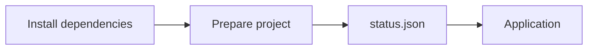

# Cloudera Blueprint: Optagent

[](LICENSE)
[](https://www.python.org/downloads/)

Project template for a Cloudera Machine Learning AMP. Copy it when a new prototype needs a catalog entry, a workbench runbook, and a local devenv shell that runs the same scripts.

## Table of Contents

- [Overview](#overview)
- [Demo](#demo)
- [Use Case](#use-case)
- [Key Features](#key-features)
- [Quickstart](#quickstart)
- [Architecture](#architecture)
- [Target Audience](#target-audience)
- [Repository Structure](#repository-structure)
- [Prerequisites](#prerequisites)
- [Hardware Requirements](#hardware-requirements)
- [Documentation](#documentation)
- [Copy this template](#copy-this-template)

## Overview

Optagent launches as an Applied ML Prototype. The workbench installs `requirements.txt`, writes a status snapshot, and serves that snapshot. On a workstation, devenv runs those same two scripts. The shell is Python 3.12 with uv. CML does not read `devenv.nix`.



## Demo

A Reprise walkthrough is not recorded yet. Leave `reprise_link` empty in [`METADATA.yaml`](METADATA.yaml) until one exists.

Locally, `devenv up` serves the page at <http://127.0.0.1:8123>. The page shows the greeting and the time the prepare job wrote the snapshot.

## Use Case

New prototypes need the same CML shape every time: a catalog entry, a `.project-metadata.yaml` runbook, numbered steps, and a local environment that can run those steps before anyone opens a workbench. This repository is that shape, with a small job and application so the launch path succeeds before the real workload replaces them.

## Key Features

- A CML runbook that creates two jobs, runs them, and starts the application
- Install, prepare, and serve scripts that find the project when CML leaves `__file__` unset
- A devenv shell that syncs the project with uv and supervises the same prepare job and application
- Catalog files for a custom AMP source and for the blueprint website
- Tests that keep the runbook, the dependency lists, and the devenv shell aligned

## Quickstart

1. Clone this repository.
2. Enter the devenv shell. With direnv, `direnv allow`. Otherwise run `devenv shell`.
3. Run the tests and serve the page:

   ```bash
   just test
   devenv up
   ```

   Then open <http://127.0.0.1:8123>. `just prepare` rewrites `assets/data/status.json`. `just app` serves the page without the process supervisor.

4. To launch it from a CML AMP catalog, add this repository as a catalog source and set the catalog file to [`catalog-entry.yaml`](catalog-entry.yaml). Site Administration steps are in [Adding a catalog](https://docs.cloudera.com/machine-learning/cloud/manage-amp/topics/ml-amp-add-catalog.html).

   CML reads [`.project-metadata.yaml`](.project-metadata.yaml) and runs the tasks in order:

   | Step | Type | What it does |
   | --- | --- | --- |
   | Install Dependencies | `create_job` + `run_job` | Installs `requirements.txt` into the workbench Python |
   | Prepare project | `create_job` + `run_job` | Writes `assets/data/status.json` |
   | Optagent | `start_application` | Serves the snapshot on `CDSW_APP_PORT` |

   The jobs stay in the project. Run **Install Dependencies** again from the Jobs tab when `requirements.txt` changes.

## Architecture

The package in `src/optagent` holds the snapshot writer. The numbered folders are the CML steps, in order. Devenv starts the prepare job, then the application.

Component detail is in [docs/architecture.md](docs/architecture.md).

## Target Audience

- Developers packaging an internal prototype for Cloudera Machine Learning
- Solution architects who need a catalog entry and a one-click launch path
- Platform engineers checking that a new AMP uses the job runbook and a devenv shell

## Repository Structure

| Path | Description |
| --- | --- |
| `src/optagent/` | Snapshot writer shared by the job and the application |
| `0_session-install-dependencies/` | CML job that installs `requirements.txt` |
| `1_job-prepare-project/` | CML job that writes the status snapshot |
| `2_app-serve/` | CML application that serves the snapshot |
| `assets/data/` | Generated status snapshot |
| `devenv.nix` | Local Python 3.12 environment, uv sync, and the two processes |
| `requirements.txt` | Runtime dependencies installed by the CML job |
| `docs/architecture.md` | Runbook, ports, and configuration |
| `METADATA.yaml` | Catalog metadata for the Cloudera blueprint website |
| `catalog-entry.yaml` | CML AMP catalog entry |
| `.project-metadata.yaml` | CML runtime and task runbook |
| `tests/` | Runbook, devenv, snapshot, and page checks |

## Prerequisites

- [devenv](https://devenv.sh/) and [direnv](https://direnv.net/) for local runs
- Python 3.12 is provided by the devenv shell
- A Cloudera Machine Learning workspace with a PBJ Workbench runtime on Python 3.12 or 3.13, or JupyterLab on Python 3.12, Standard edition, when launching the AMP
- No API keys. `OPTAGENT_GREETING` and `OPTAGENT_STATUS_PATH` have defaults

## Hardware Requirements

| Deployment | Minimum |
| --- | --- |
| Launchable / demo | 1 CPU, 2 GB RAM, no GPU |
| Production / enterprise | Size the workload you add. The template jobs request 1 CPU and 2 GB |

## Documentation

- [Architecture](docs/architecture.md)
- [AMP project specification](https://docs.cloudera.com/machine-learning/cloud/applied-ml-prototypes/topics/ml-amp-project-spec.html)
- [Catalog file specification](https://docs.cloudera.com/machine-learning/cloud/manage-amp/topics/ml-amp-catalog-spec.html)
- [Creating new AMPs](https://docs.cloudera.com/machine-learning/cloud/applied-ml-prototypes/topics/ml-amp-create-new-amp.html)

## Copy this template

Keep the task order and the devenv shell. Replace the sample workload.

| Change | Where |
| --- | --- |
| Prototype name, slug, maintainer | `METADATA.yaml`, `catalog-entry.yaml`, `.project-metadata.yaml` |
| `git_url` and `git_ref` | `catalog-entry.yaml` |
| Subdomain | `.project-metadata.yaml` `subdomain` |
| Python package | `src/optagent/`, `pyproject.toml` `name` |
| Runtime dependencies | `requirements.txt` and `[project].dependencies`, same names in both |
| Prepare job | `1_job-prepare-project/job.py` and `processes.prepare` |
| Application | `2_app-serve/app.py` and `processes.app` |

The install task stays a job. Give each `create_job` a `kernel: python3` and `arguments: ""`. Point `languages.python.package` at `pkgs.python312`, and install local tools with `uv.sync`.
