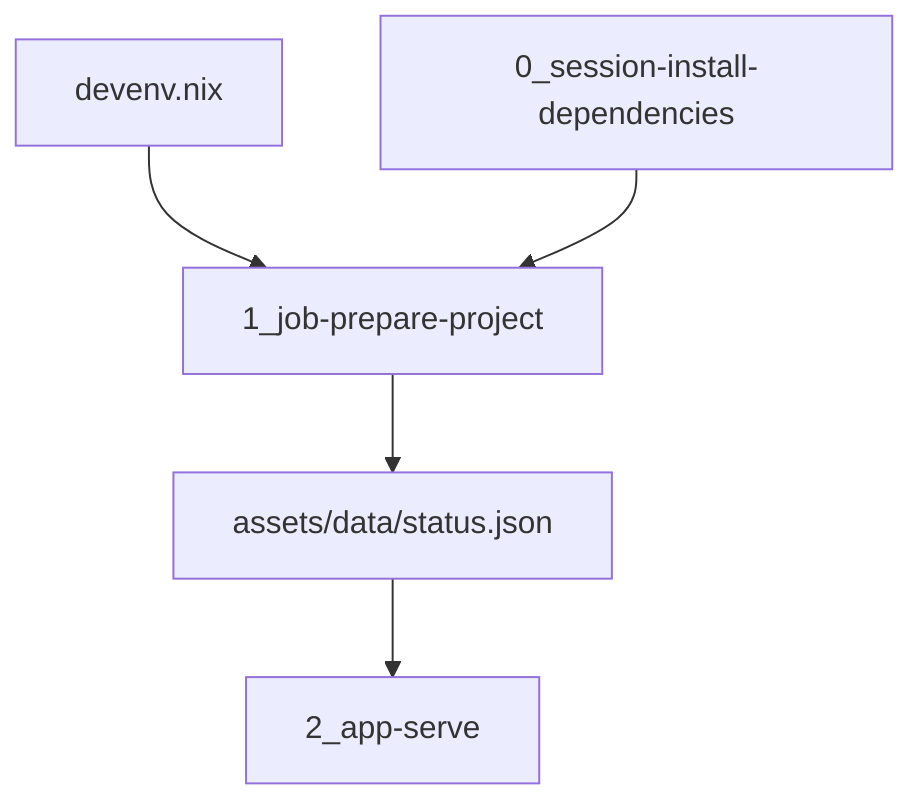

# Architecture

Optagent is the project template for a Cloudera Machine Learning AMP. The same three scripts run locally and in the workbench. Devenv is the local supervisor. `.project-metadata.yaml` is the workbench runbook.

| Piece | Role |
| --- | --- |
| `devenv.nix` | Local Python 3.12 environment. `languages.python` with uv syncs the project, including the `dev` extra. `processes.prepare` is the one-shot job. `processes.app` serves the page on port 8123 after that job finishes |
| `0_session-install-dependencies` | CML job that installs `requirements.txt`. The directory keeps the community template name. The task type is `create_job` / `run_job`. PBJ runtimes fail AMP setup steps that run as sessions |
| `1_job-prepare-project` | Writes the status snapshot. Imports the model from `src/` |
| `2_app-serve` | Serves the snapshot. Listens on `127.0.0.1`. CML sets `CDSW_APP_PORT`. Locally the port is 8123 |
| `.project-metadata.yaml` | CML runbook. PBJ Workbench on Python 3.12 or 3.13, and JupyterLab on Python 3.12, Standard edition |
| `catalog-entry.yaml` | Entry for a custom CML AMP catalog |
| `METADATA.yaml` | Fields for the Cloudera blueprint website |

## Why the scripts look the way they do

CML executes a job script in a notebook cell, so `__file__` is unset. Each script finds the repository from `CDSW_PROJECT_DIR` or `ML_PROJECT_DIR`, then from the working directory.

The install job does not build the package. An editable install inside a Cloudera session fails the engine. The job and the application insert `src/` on the import path instead. Runtime dependencies belong in `requirements.txt` and in `[project].dependencies`. The names stay in lockstep. The `dev` extra (pytest) stays local and is installed by `uv.sync.extras`.

A finished install job remains in the project. Run it again from the Jobs tab when dependencies change. That does not require launching the AMP again.

## Request path

`GET /health` returns `ok`. `GET /` renders the greeting. When the snapshot exists, the page shows the recorded greeting, the prototype version, and the time the job wrote the file. When it does not, the page says the prepare job has not run and shows `OPTAGENT_GREETING`.

## Configuration

| Variable | Default | Used for |
| --- | --- | --- |
| `OPTAGENT_GREETING` | `Hello from the Optagent AMP template.` | Text the job records and the page shows before a snapshot exists |
| `OPTAGENT_STATUS_PATH` | `assets/data/status.json` | Snapshot path. Relative paths are inside the repository |
| `PORT` | `8123` when unset | Listen port. The devenv process sets `8123` |
| `CDSW_APP_PORT` | | Listen port inside CML, used when `PORT` is unset |
| `CDSW_PROJECT_DIR`, `ML_PROJECT_DIR` | | Repository root inside CML |

## Copy this template

Rename the package, the catalog title, the subdomain, and the job script when the prototype grows a real workload. Keep the task order: install job, project job, application. Add a model task only when the prototype deploys one. The task types are in the [AMP project specification](https://docs.cloudera.com/machine-learning/cloud/applied-ml-prototypes/topics/ml-amp-project-spec.html).
