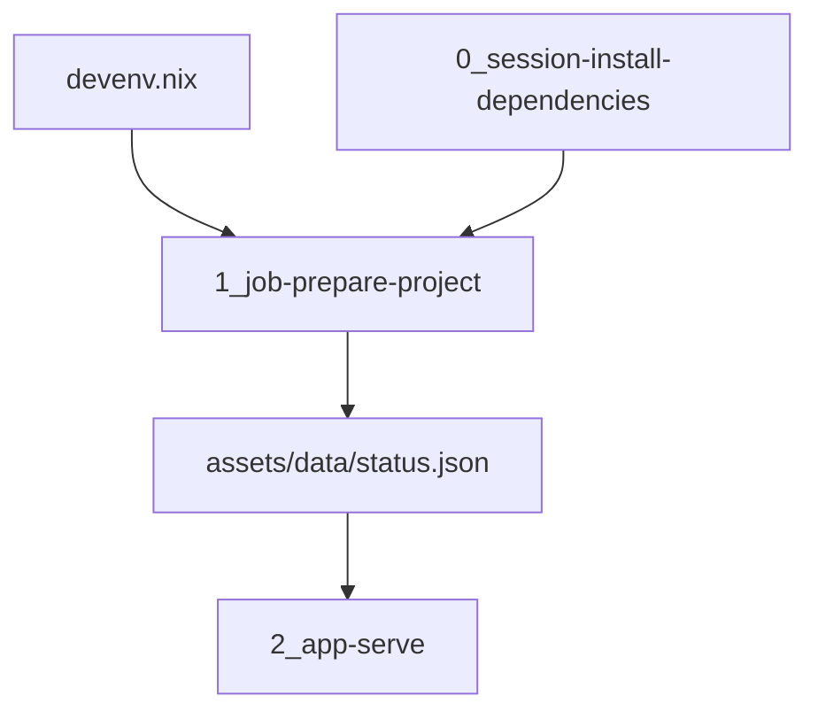

# Architecture

Optagent is the project template for a Cloudera Machine Learning AMP. The same three scripts run locally and in the workbench. Devenv is the local supervisor. `.project-metadata.yaml` is the workbench runbook.



| Piece | Role |
| --- | --- |
| `devenv.nix` | Local Python 3.12 environment and PostgreSQL 16 on port 5466. `languages.python` with uv syncs the project, including the `dev` extra. `processes.prepare` is the one-shot job. `processes.app` serves the page on port 8123 after that job finishes |
| `components/impala_fdw` | `weathership/impala_fdw` `trunk`. Native PostgreSQL extension. Kudu scans and writes use `kudu_scan`. Iceberg tables and Impala UNION views use `impala_sql` |
| `0_session-install-dependencies` | CML job that installs `requirements.txt`. The directory keeps the community template name. The task type is `create_job` / `run_job`. PBJ runtimes fail AMP setup steps that run as sessions |
| `1_job-prepare-project` | Writes the status snapshot. Imports the model from `src/` |
| `2_app-serve` | Serves the snapshot. Listens on `127.0.0.1`. CML sets `CDSW_APP_PORT`. Locally the port is 8123 |
| `.project-metadata.yaml` | CML runbook. PBJ Workbench on Python 3.12 or 3.13, and JupyterLab on Python 3.12, Standard edition |
| `catalog-entry.yaml` | Entry for a custom CML AMP catalog |
| `METADATA.yaml` | Fields for the Cloudera blueprint website |

## Why the scripts look the way they do

CML executes a job script in a notebook cell, so `__file__` is unset. Each script finds the repository from `CDSW_PROJECT_DIR` or `ML_PROJECT_DIR`, then from the working directory.

The install job does not build the package. An editable install inside a Cloudera session fails the engine. The job and the application insert `src/` on the import path instead. Runtime dependencies belong in `requirements.txt` and in `[project].dependencies`. The names stay in lockstep. The `dev` extra (pytest) stays local and is installed by `uv.sync.extras`.

A finished install job remains in the project. Run it again from the Jobs tab when dependencies change. That does not require launching the AMP again.

## Warehouse

Gaius (`:5444`) and Signals (`:5455`) query Kudu and Iceberg through `impala_fdw` on native PostgreSQL. Optagent uses the same extension on its own postmaster, port **5466**, database `optagent`. The submodule is `git@github.com:weathership/impala_fdw.git`, branch `trunk`.

ElectricSQL PGlite, the WASM build Atelier starts in a workbench, cannot load this PGXS `.so`. The AMP job `scripts/warehouse/register_impala_fdw.py` builds and registers the extension when PostgreSQL headers and Thrift are on the worker. A stock PBJ image has neither, so that job records the skip and the launch continues. Locally:

```bash
devenv up
devenv tasks run impala-fdw:install
```

`impala-fdw:install` builds first. The link uses the Nix thrift on the task (`THRIFT_HOME` / `BOOST_HOME`), not the Impala toolchain's libthrift 0.16. Without `libkudu_client` the build is HS2-only: Kudu and Iceberg still answer through Impala. With the client library, `kudu_scan` is compiled in.

`IMPALA_HS2_HOST` empty means the wrapper is installed and `CREATE SERVER` is skipped. When the host is set, the server is `impala_kudu_srv` with `auth 'kerberos'`. A user mapping is added only when `IMPALA_KRB_PRINCIPAL` and `IMPALA_KRB_KEYTAB` are both set. `IMPALA_FDW_AUTH` accepts `kerberos` only.

Foreign tables are not created by the template. A Kudu table uses `access 'kudu_scan'`. An Iceberg table or a UNION view uses `access 'impala_sql'`.

## Posture

`config/base.conf` is the HOCON source. `posture = local` is the devenv default: Postgres on port 5466 and `impala_fdw`. `posture = amp` is the workbench: Impala HS2 directly, no FDW registration, no local Postgres. `.project-metadata.yaml` sets `OPTAGENT_POSTURE=amp`. A devenv shell does not.

The amp baseline is a SOPS dotenv. `config/amp.env.example` lists the keys. After `.sops.yaml` names this project's age recipient, `sops` writes `.env.cai.enc`. `scripts/bootstrap-secrets.sh` decrypts it when `SOPS_AGE_KEY` or `SOPS_AGE_KEY_FILE` is set. The devenv shell does not call that script, and it does not install `sops`, Impala, or Spark.

`OPTAGENT_CDE_ENABLED` records that Cloudera Data Engineering will join the amp posture later. The flag does not import Spark.

`OPTAGENT_TRACES_S3_URI` is one `s3://` prefix. The local shell publishes agent session objects there, under `.../<machine>/raw/<agent>/...`. The AMP reads that same prefix. The settings gear is Ægir's outlined settings mark, and the page shows the prefix.

An explicit environment variable wins over the decrypted file.

## Span ledger

`span` is the relation readers query. It is not a copy of a Signals series and it is not Gaius `cognition_thoughts`.

| Relation | Store | FDW access | Write |
| --- | --- | --- | --- |
| `optagent.span_tier0` | Kudu | `kudu_scan` | INSERT |
| `optagent.span_tier1` | Iceberg | `impala_sql` | none |
| `optagent.span` | Impala view | `impala_sql` | none |

The view is tier0 `UNION ALL` tier1, and a tier1 hour still present in tier0 is masked. That is the same hour rule Signals uses for `tx` and `hx_reasoning`. `impala_fdw_exec` creates the view. tier1 is a catalog table. The module does not emit `CREATE TABLE … STORED AS ICEBERG`.

Columns on every tier, schema-identical: `epoch_hour`, `span_id`, `agent`, `kind`, `seq`, `opened_ns`, `summary`, `body`, `body_uri`. `kind` is `span` or `synthesis`. `body` is the hot transcript. After the hour settles, the body lives on tier1 and `body_uri` can name the object.

## Sessions

The application opens on the empty AgentsView home: the Sessions tab, an empty session list, and the analytics cards at zero. That is the screen AgentsView shows when no session is selected. Usage, Activity, Trends, Recall, Pinned, Quality, Trash, Recent Edits, and Data use the same chrome and say there is no data yet. The deployment readout stays at `/ledger`.

The session browser source is the local agentsview checkout `../../rch/oss-agentsview` (`weathership/oss-agentsview`). `go.work` uses that tree. `ui/go.mod` replaces `go.kenn.io/agentsview` with it. `ui/package.json` links `agentsview-frontend` to `frontend/`. `/sessions` names that checkout.

## Request path

`GET /health` returns `ok`. `GET /` renders the greeting. When the snapshot exists, the page shows the recorded greeting, the prototype version, and the time the job wrote the file. When it does not, the page says the prepare job has not run and shows `OPTAGENT_GREETING`.

## Configuration

| Variable | Default | Used for |
| --- | --- | --- |
| `OPTAGENT_DB_URL` | `postgres://127.0.0.1:5466/optagent` | Postgres that loads `impala_fdw` |
| `IMPALA_HS2_HOST` | empty | Impala HS2 host. Empty skips `CREATE SERVER` |
| `IMPALA_HS2_PORT` | `21050` | Impala HS2 port |
| `KUDU_MASTERS` | empty | Kudu masters. Empty uses `IMPALA_HS2_HOST:7051` |
| `IMPALA_KRB_PRINCIPAL` | empty | Kerberos principal for the user mapping |
| `IMPALA_KRB_KEYTAB` | empty | Keytab path for the user mapping |
| `IMPALA_FDW_AUTH` | `kerberos` | The only accepted auth value |
| `OPTAGENT_GREETING` | `Hello from the Optagent AMP template.` | Text the job records and the page shows before a snapshot exists |
| `OPTAGENT_STATUS_PATH` | `assets/data/status.json` | Snapshot path. Relative paths are inside the repository |
| `PORT` | `8123` when unset | Listen port. The devenv process sets `8123` |
| `CDSW_APP_PORT` | | Listen port inside CML, used when `PORT` is unset |
| `CDSW_PROJECT_DIR`, `ML_PROJECT_DIR` | | Repository root inside CML |

## Copy this template

Rename the package, the catalog title, the subdomain, and the job script when the prototype grows a real workload. Keep the task order: install job, project job, application. Add a model task only when the prototype deploys one. The task types are in the [AMP project specification](https://docs.cloudera.com/machine-learning/cloud/applied-ml-prototypes/topics/ml-amp-project-spec.html).
