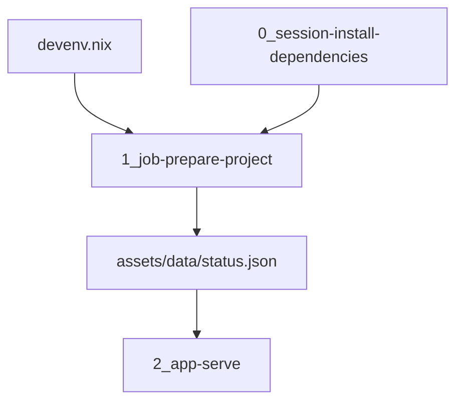

# Architecture

Optagent is the project template for a Cloudera Machine Learning AMP. The same three scripts run locally and in the workbench. Devenv is the local supervisor. `.project-metadata.yaml` is the workbench runbook.



| Piece | Role |
| --- | --- |
| `devenv.nix` | Local Python 3.12 environment, Rust 1.94.0 (`languages.rust`), and PostgreSQL 16 on port 5599. `languages.python` with uv syncs the project, including the `dev` extra. `just grok-build` compiles `zndx/oss-grok-build` with that toolchain. `processes.prepare` is the one-shot job. `processes.app` serves the page on lattice port 9892 after that job finishes |
| `corpora` | Pinned `sdg-corpora` release (`97957d0ae2b210b75b4eaedf5ae6588ff84126b9`). Lexicon and schema panels read this tree. `just corpora` initializes the submodule |
| `components/impala_fdw` | `weathership/impala_fdw` `trunk`. Native PostgreSQL extension. Kudu scans and writes use `kudu_scan`. Iceberg tables and Impala UNION views use `impala_sql` |
| `0_session-install-dependencies` | CML job that installs `requirements.txt`. The directory keeps the community template name. The task type is `create_job` / `run_job`. PBJ runtimes fail AMP setup steps that run as sessions |
| `1_job-prepare-project` | Writes the status snapshot. Imports the model from `src/` |
| `2_app-serve` | Serves the UI. Listens on `127.0.0.1`. CML sets `CDSW_APP_PORT`. Locally the port is **9892** |
| `.project-metadata.yaml` | CML runbook. PBJ Workbench on Python 3.12 or 3.13, and JupyterLab on Python 3.12, Standard edition |
| `catalog-entry.yaml` | Entry for a custom CML AMP catalog |
| `METADATA.yaml` | Fields for the Cloudera blueprint website |

## Standalone host

OptAgent builds and serves a snapshot with this repository alone. Signals at `~/local/src/wxs/signals` is the only sibling it needs, and only when a run publishes a warehouse product (`SIGNALS_ROOT` overrides that path). Federated projects are independent data sources. Gaius, Aegir, Atelier, Hermes, Metabase, and Semantica are not checkouts the build, the Summary page, or the AMP requires.

`just corpora` runs `git submodule update --init corpora`. `OPTAGENT_SDG_CORPORA` selects another vocabulary tree. Aperture admission is optional: set `AEGIR_ROOT` so that checkout is on `PYTHONPATH`, and `AEGIR_PYTHON` when that tree's interpreter has to run the encoder. HX export runs only when `OPTAGENT_GAIUS_PYTHON` names an interpreter. Semantica harvest runs only when `SEMANTICA_DATABASE_URL` is set. Harvest writes under `build/signals-snapshot` unless `OPTAGENT_HARVEST_OUT` is set.

The terminal harness is Grok Build, running in the app process. Ghostty-web is the terminal. The page attaches at `/ws/terminal/{id}`: keystrokes and output are websocket frames, closing the socket detaches, and the grok process keeps running so the next attach can replay the byte log. The HTTP output poll remains for a client that never completes the upgrade. The model endpoint is `terminal.models` in `config/base.conf`, overridden by `OPTAGENT_MODEL_BASE_URL` or replaced by `OPTAGENT_MODELS_JSON`. An empty selection keeps Grok's built-in catalog. `OPTAGENT_MODEL=mistral` uses `https://api.mistral.ai/v1` with `MISTRAL_API_KEY`. `OPTAGENT_MODEL=mistral-studio` uses the same API with the workspace-scoped `MISTRAL_WORKSPACE_API_KEY` and shows `MISTRAL_WORKSPACE_ID`. On a workstation those values are read from the process environment or `~/local/.env` when unset. The AMP sets the same names in the project environment. Keys are not written into the session. A new session picks up a changed endpoint.

## Why the scripts look the way they do

CML executes a job script in a notebook cell, so `__file__` is unset. Each script finds the repository from `CDSW_PROJECT_DIR` or `ML_PROJECT_DIR`, then from the working directory.

The install job does not build the package. An editable install inside a Cloudera session fails the engine. The job and the application insert `src/` on the import path instead. Runtime dependencies belong in `requirements.txt` and in `[project].dependencies`. The names stay in lockstep. The `dev` extra (pytest) stays local and is installed by `uv.sync.extras`.

A finished install job remains in the project. Run it again from the Jobs tab when dependencies change. That does not require launching the AMP again.

## Warehouse

Gaius (`:5444`) and Signals (`:5455`) query Kudu and Iceberg through `impala_fdw` on native PostgreSQL. Optagent uses the same extension on its own postmaster, port **5599**, database `optagent`. The submodule is `git@github.com:weathership/impala_fdw.git`, branch `trunk`.

ElectricSQL PGlite, the WASM build Atelier starts in a workbench, cannot load this PGXS `.so`. The AMP job `scripts/warehouse/register_impala_fdw.py` builds and registers the extension when PostgreSQL headers and Thrift are on the worker. A stock PBJ image has neither, so that job records the skip and the launch continues. Locally:

```bash
devenv up
devenv tasks run impala-fdw:install
```

`impala-fdw:install` builds first. The link uses the Nix thrift on the task (`THRIFT_HOME` / `BOOST_HOME`), not the Impala toolchain's libthrift 0.16. Without `libkudu_client` the build is HS2-only: Kudu and Iceberg still answer through Impala. With the client library, `kudu_scan` is compiled in.

`IMPALA_HS2_HOST` empty means the wrapper is installed and `CREATE SERVER` is skipped. When the host is set, the server is `impala_kudu_srv` with `auth 'kerberos'`. A user mapping is added only when `IMPALA_KRB_PRINCIPAL` and `IMPALA_KRB_KEYTAB` are both set. `IMPALA_FDW_AUTH` accepts `kerberos` only.

Foreign tables are not created by the template. A Kudu table uses `access 'kudu_scan'`. An Iceberg table or a UNION view uses `access 'impala_sql'`.

## Posture

`config/base.conf` is the HOCON source. `posture = local` is the devenv default: Postgres on port 5599 and `impala_fdw`. `posture = amp` is the workbench: Impala HS2 directly, no FDW registration, no local Postgres. `.project-metadata.yaml` sets `OPTAGENT_POSTURE=amp`. A devenv shell does not.

The amp baseline is a SOPS dotenv. `config/amp.env.example` lists the keys. After `.sops.yaml` names this project's age recipient, `sops` writes `.env.cai.enc`. `scripts/bootstrap-secrets.sh` decrypts it when `SOPS_AGE_KEY` or `SOPS_AGE_KEY_FILE` is set. The devenv shell does not call that script, and it does not install `sops`, Impala, or Spark.

`OPTAGENT_CDE_ENABLED` records that Cloudera Data Engineering will join the amp posture later. The flag does not import Spark.

`OPTAGENT_TRACES_S3_URI` is one `s3://` prefix for a full session archive. Sample mode does not use it.

`signals-snapshot` is a root pointer in the Iceberg sense, the role Project Nessie plays for a metadata file. The document names federated members (Kudu, Iceberg, files, relational) by `metadata-location`. It does not contain the table bytes. A deployment adds a project or a kind the loader has not seen. Unknown kinds are kept. The bundled sample lists Signals, Gaius, Atelier, Ægir, Metabase, and Semantica.

The browser talks to the application on `:9892`. Varnish listens on `:6095`, the next port after Atelier `:6094`, and caches `GET /api/optagent/v1/snapshot_origin` for 60 seconds with 6 hours of grace. The workspace route asks Varnish first and builds the document itself when Varnish is down. That is the same shape as Gaius Cognition's discover route and Ægir's lineup: the slow read is an origin document, and the page renders from the cache.

HOCON in `config/base.conf` is the deployment default. A browser session, stored under `.devenv/state` and named by the `optagent_sid` cookie, may override sample mode. The URL does not. The Kumo `Switch` posts to `/api/optagent/v1/sample-mode`. With sample mode on, the page is an AgentsView session whose lineup is the snapshot members, the same list-and-detail gesture as Ægir's lineup. `optagent.viz.chord_tables` is the HoloViews and Datashader input for that lineup. The `viz` extra supplies those libraries. The default install does not.

Sample mode is `OPTAGENT_SAMPLE_MODE` plus that session override. The AMP turns it on so a walkthrough runs before Impala answers. The snapshot URI is `OPTAGENT_SNAPSHOT_S3_URI`. On a workstation the endpoint is Signals' RustFS at `http://127.0.0.1:9010`. This project does not run that store. In the AMP the endpoint is empty and the URI is AWS S3.

An explicit environment variable wins over the decrypted file.

## Span ledger

`span` is the relation readers query. It is not a copy of a Signals series and it is not Gaius `cognition_thoughts`.

| Relation | Store | FDW access | Write |
| --- | --- | --- | --- |
| `optagent.span_tier0` | Kudu | `kudu_scan` | INSERT |
| `optagent.span_tier1` | Iceberg | `impala_sql` | none |
| `optagent.span` | Impala view | `impala_sql` | none |

The view is tier0 `UNION ALL` tier1, and a tier1 hour still present in tier0 is masked. That is the same hour rule Signals uses for `tx` and `hx_reasoning`. `impala_fdw_exec` creates the view. tier1 is a catalog table. The module does not emit `CREATE TABLE … STORED AS ICEBERG`.

Columns on every tier, schema-identical: `epoch_hour`, `span_id`, `agent`, `kind`, `seq`, `opened_ns`, `summary`, `body`, `body_uri`. `kind` is `span` or `synthesis`. `body` is the hot transcript. After the hour settles, the body lives on tier1 and `body_uri` can name the object.

## Sessions

The application opens on the empty AgentsView home: the Sessions tab, an empty session list, and the analytics cards at zero. That is the screen AgentsView shows when no session is selected. Usage, Activity, Trends, Recall, Pinned, Quality, Trash, Recent Edits, and Data use the same chrome and say there is no data yet. The deployment readout stays at `/ledger`.

The session browser source is the local agentsview checkout `../../rch/oss-agentsview` (`weathership/oss-agentsview`). `go.work` uses that tree. `ui/go.mod` replaces `go.kenn.io/agentsview` with it. `ui/package.json` links `agentsview-frontend` to `frontend/`. `/sessions` names that checkout.

## Request path

`GET /health` returns `ok`. `GET /` renders the greeting. When the snapshot exists, the page shows the recorded greeting, the prototype version, and the time the job wrote the file. When it does not, the page says the prepare job has not run and shows `OPTAGENT_GREETING`.

## Configuration

| Variable | Default | Used for |
| --- | --- | --- |
| `OPTAGENT_DB_URL` | `postgres://127.0.0.1:5599/optagent` | Postgres that loads `impala_fdw` |
| `IMPALA_HS2_HOST` | empty | Impala HS2 host. Empty skips `CREATE SERVER` |
| `IMPALA_HS2_PORT` | `21050` | Impala HS2 port |
| `KUDU_MASTERS` | empty | Kudu masters. Empty uses `IMPALA_HS2_HOST:7051` |
| `IMPALA_KRB_PRINCIPAL` | empty | Kerberos principal for the user mapping |
| `IMPALA_KRB_KEYTAB` | empty | Keytab path for the user mapping |
| `IMPALA_FDW_AUTH` | `kerberos` | The only accepted auth value |
| `OPTAGENT_GREETING` | `Hello from the Optagent AMP template.` | Text the job records and the page shows before a snapshot exists |
| `OPTAGENT_STATUS_PATH` | `assets/data/status.json` | Snapshot path. Relative paths are inside the repository |
| `PORT` | `9892` when unset | Listen port. The devenv process sets `9892` |
| `OPTAGENT_BIND` | `0.0.0.0` on the workstation, `127.0.0.1` in CML | Listen address. `0.0.0.0` is what Signals and Gaius use so the hostname works |
| `OPTAGENT_PRIMARY_UI` | `http://tinybox.dev.vista.zndx.org:9892` | Lattice URL for this UI. Signals is `:9889`. Gaius is `:9890` |

`devenv up` binds the UI on `0.0.0.0:9892`, so <http://tinybox.dev.vista.zndx.org:9892> answers, and the lattice engine at `:50851`. `optagent.service` is a `signals.target` member: `PartOf=` and `WantedBy=signals.target`, `After=signals-ready.service`. Start and stop run `scripts/systemd_start.sh` and `scripts/systemd_stop.sh`, which only touch this checkout. Postgres is `:5599`, the next free slot after Semantica `:5588`. It does not bind Signals `:5455` or RustFS `:9010`.

`Engine/Status` reports `project=optagent`, no hosted model, and a primary surface at `:9892` whose `healthy` flag follows whether that port accepts a connection. Server reflection is enabled. Signals lists the UI in the waffle after this engine is in some seed's `PEERS` (the contract entry is `engine_grpc_lattice.optagent = 50851`). The amp posture still queries Signals Impala rather than this postmaster.
| `CDSW_APP_PORT` | | Listen port inside CML, used when `PORT` is unset |
| `CDSW_PROJECT_DIR`, `ML_PROJECT_DIR` | | Repository root inside CML |

## Copy this template

Rename the package, the catalog title, the subdomain, and the job script when the prototype grows a real workload. Keep the task order: install job, project job, application. Add a model task only when the prototype deploys one. The task types are in the [AMP project specification](https://docs.cloudera.com/machine-learning/cloud/applied-ml-prototypes/topics/ml-amp-project-spec.html).
